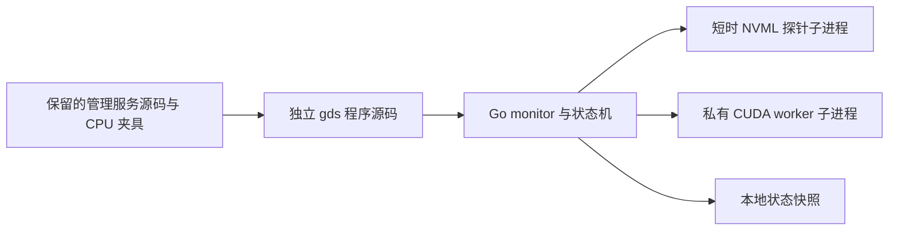

# GDS 独立源码设计与历史边界

自 2026 年 10 月 19 日起，GDS 仅在 [standalone/gds](../standalone/gds/README.md) 保留独立源码和专属测试。当前 Nido 源码不注册 GDS，不提供 `nido gds` 命令；根模块的构建、测试、CI 和发行流程均不接入 GDS。本次不安装、迁移、清理既有 GDS 部署，也不自动发布独立程序。

GDS 的设计目标是在持续观察到目标 GPU 空闲后分配指定显存，发现外部活动或失去可靠观察时释放。保留的实现包括管理服务、状态机、worker 协议和 Linux amd64 原生适配。真实 GPU 验收尚未完成；编译、CPU 协议与假驱动结果不能证明真实显存分配、释放或负载影响。

Nido v0.5.0 与 GDS v0.1.0 的接入和发布属于历史事实，见 [发行记录](gds-release.md) 与 [审计记录](gds-audit.md)。下文保留技术设计与当时的接口约定；标为历史的命令、安装布局和发行计划不构成当前可用入口。

核心选择是：独立程序、UUID 设备身份、NVML 结构化探测、无计算 kernel 的显存 worker，以及失效自动到期的占用许可。GDS 的 NVIDIA 依赖只属于自己的 Go 模块。

## 源码设计目标与首版范围

原首版目标面向 Linux amd64、普通用户、宿主机同一 PID 视图中的一张完整 NVIDIA GPU。GPU 必须显式选择；不默认为第 0 张。不支持的平台由源码中的后端明确返回 unsupported。这些目标仍需真实 GPU 验收。

| 能力 | 首版约定 |
| --- | --- |
| 自动占用 | 连续空闲达到阈值后尝试保留显存，默认 30 分钟、总显存 25% |
| 自动让出 | 新鲜探测发现外部活动即停止自身 worker；探测失败、超时或过期也让出 |
| 可靠使用前释放 | 管理层必须等待 monitor 及 worker 全部退出；确认成功后才可启动实际任务 |
| 历史安装与更新约定 | 用户显式安装；停止状态替换程序；完成后仍停止；当前无安装入口 |
| 状态查询 | 本地只读，分别展示调度器、worker、采样新鲜度与异常原因 |
| 独立运行 | 不依赖 Codex、Proxy、tmux、Python 或系统服务管理器 |

自动让出存在观察窗口。新程序可能在窗口内先申请显存并失败，因此 GDS 不能保证任意直接启动的任务不受影响。这个结论来自并发时序：CUDA 分配不足会返回失败，而后续释放不能撤回失败，见 [CUDA 显存分配接口](https://docs.nvidia.com/cuda/cuda-driver-api/group__CUDA__MEM.html)。降低轮询间隔只能缩短窗口。

需要确定顺序时，原设计要求先确认 monitor 与 worker 全部退出，再运行实际 GPU 任务，任务结束后才按需重新启用观察。历史上的 Nido 启停接口现已摘除，本文不提供当前部署的停止、接管或清理命令。该顺序即使成立，也只处理本 GDS，不能排除其他进程竞争。首版设计未增加任务队列、exec 包装器、pause 租约服务或控制 socket。

默认只保留显存，不持续运行 kernel。显存保留不会保证 GPU 利用率、功耗或平台空闲回收策略满足某个指标。如果实际目标包含持续计算活动，应另行定义负载上限并实测，再显式增加活动模式；不沿用“单线程所以没有干扰”的推断。

首版不支持 MIG、MPS、vGPU、容器与宿主不一致的 PID 视图、多卡联动、EXCLUSIVE_PROCESS 计算模式、权限提升、跨用户协调或集群调度。特别是 EXCLUSIVE_PROCESS 下，占位 context 可能阻止其他 context 建立，外部活动轮询无法提供有效让出。只要设备模式或观测完整性无法确认，就拒绝保留。

## 组件与代码边界



| 代码位置 | 职责 |
| --- | --- |
| `standalone/gds/go.mod` | 独立模块 `github.com/MiracleHYH/CDEToolkit/standalone/gds` 与独立依赖 |
| `standalone/gds/internal/components/gds` | 保留的安装、配置、精确启停、状态、日志和静态预检实现；没有 Nido 入口 |
| `standalone/gds/cmd/gds` | 独立程序源码，含前台 run 和内部 probe/worker 模式；当前不发行 |
| `standalone/gds/internal/gdsapi`、`standalone/gds/internal/gdsutil` | 模块内的配置、协议、文件和进程辅助实现 |
| `standalone/gds/internal/gdsruntime` | 可注入时钟、探针与 worker 的状态机、进程编排和占用许可 |
| `standalone/gds/internal/gdsruntime/nvidia` | Linux 原生适配，NVML 查询与 CUDA Driver API 的最小绑定 |

嵌套模块不加入根 `go.work`，根模块也不通过 require/replace 引入它；根目录的 `go test ./...` 不遍历该模块。开发检查需进入 `standalone/gds` 并显式设置 `GOWORK=off`。NVIDIA 官方 [go-nvml](https://github.com/NVIDIA/go-nvml) 依赖仅保留在独立模块，根 Nido 不携带它。

CUDA 侧只封装 Driver API 所需的小范围接口，运行时加载驱动库。NVIDIA 原生文件采用 `linux && amd64 && cgo` 构建约束，其他平台或禁用 cgo 时提供明确 unsupported 的适配，不链接 CUDA/NVML。状态机与 CPU 协议测试保留在模块内。当前只提供源码检查与显式 CPU 假驱动隔离测试；未来如恢复发行，仍需重新固定并验证 glibc 基线、驱动最低版本和可用符号，不能把 ELF 架构匹配等同于运行兼容。

monitor、probe 和 worker 使用同一份受管 gds 程序的不同启动模式，便于校验程序与协议版本。GPU 状态机不放进 Nido CLI 进程，也不依赖 Nido 主程序更新后的映像。组件不导入 Codex、Proxy 或 `internal/nido`。

## 历史管理目录与配置

以下是 Nido v0.5.0 集成时期的目录约定，供理解保留源码和历史记录使用。当前 Nido 不创建、读取、迁移或清理此 GDS 目录。

```text
<NIDO_HOME>/gds/
  gds                   # 独立组件程序
  installed.json        # 本地安装凭证，绑定程序摘要与协议元数据
  config.toml           # 唯一策略配置
  process.json          # monitor 启动身份与程序协议
  worker.json           # 分配授权前提交的 worker 身份
  invocation.json       # 显式辅助调用授权前提交的内核身份
  .invocation.lock      # 显式辅助调用的短期互斥
  state.json            # 最近一次观察快照，不能当控制凭据
  output.log            # 子进程输出；启动前超过 8 MiB 时轮转为单份 .1
  .lock                 # 稳定的短期管理锁
  .run.lock             # monitor 整个运行期持有的实例锁
```

不再设置 core、workdir、current、versions 或通用事务目录。Nido 主配置不重复保存 GPU、显存比例或空闲阈值。组件目录 0700，配置、记录和日志 0600，程序 0700；写入前检查路径、普通文件、所有者、硬链接与目标快照，再同目录原子替换。

安装凭证绑定实际程序摘要，程序或凭证缺失、损坏、被并发替换时拒绝启动、更新和删除，不执行路径中未知的 ELF 来判断归属。程序和凭证分两次提交，中断产生的不匹配保留现场并拒绝后续破坏性操作；首版不自动接管没有凭证的旧程序。运行记录同样绑定本轮读到或写入的 inode 与内容，后续发布和退出清理都不得重新采纳并覆盖外部编辑。

配置示例中的值是首版拟定默认值：

```toml
schema = 1
gpu_uuid = "GPU-完整设备UUID"
idle_seconds = 1800
probe_interval_seconds = 5
memory_percent = 25
min_free_mib = 1024
max_idle_utilization_percent = 5
```

未知键、重复键、非法 UUID、越界数值直接报错。idle_seconds 必须大于零，probe_interval_seconds 允许 1–10，memory_percent 允许 1–50；其他阈值要求符合设备容量及百分比范围。不静默使用默认值代替错误配置。保留的配置处理只接受完整 UUID；GPU index 的便捷解析不在首版设计内。

运行中的配置按启动快照生效；磁盘改变时显示 config_changed，通过 restart 生效。configure 只在停止状态提交；restart 在停止旧实例前完成候选静态与设备能力预检，失败保留旧实例。

## 设备身份与探测

使用 NVML 按 UUID 读取模式、总量、空闲显存、利用率、compute 与 graphics context。NVIDIA 指出 nvidia-smi 输出不保证向后兼容，维护跨驱动工具应优先 NVML，见 [官方说明](https://docs.nvidia.com/deploy/nvidia-smi/index.html)。nvidia-smi 留作人工诊断，不作为调度数据解析协议，也不自动切换为备用后端。

探针在短时子进程中执行，默认等待上限 2 秒，输出有大小限制。每轮只允许一个探针；超时后终止并回收，无法确认退出则报告 unknown、停止占用并停止派生后续探针。不能用取消 Go context 假装已经取消一个阻塞中的原生驱动调用。

仅在以下条件全部满足时认为一次采样允许累计空闲：

1. UUID、设备模式与可见范围仍符合启动检查，查询完整成功。
2. 没有本次精确核验 worker 以外的 compute 或 graphics context。外部进程即使利用率为零，也视为忙；不同用户的进程同样视为外部，不要求读取其私有数据。
3. GPU 利用率不高于配置阈值，容量与余量足够。

必需活动和容量接口返回 N/A、NOT_SUPPORTED、权限错误、GPU lost 或不完整进程列表时，不得把缺失字段解释为零。MIG 模式查询按 NVIDIA 接口语义处理：不具备 MIG 能力的设备可明确返回 NOT_SUPPORTED，此项不等于丢失活动数据。进程查询的 INSUFFICIENT_SIZE 允许在本轮截止前有界扩容重试，最终必须获得完整结果；进程数量持续变化导致无法完整获取时，本轮失败。缺少完整观察能力的设备拒绝保留。

worker 的 GPU PID 必须与同一宿主 PID 视图下已核验的 worker PID 一致，同时核对 UUID、UID、boot ID、出生信息、程序和本次启动标识。进程列表里只有一个 PID，不构成归属证据；共享 MPS server 不能被排除。MPS 无法可靠识别或映射时让出，见 [NVIDIA 对 MPS 活动归属的说明](https://docs.nvidia.com/deploy/mps/appendix-tools-and-interface-reference.html)。

宿主机同一 PID 视图是部署前提。已知容器标记与自身 namespace 检查可以保守拒绝部分环境，不能证明初始 namespace，也不构成容器安全边界；不要求普通用户读取 root 的 namespace。

启动预检尊重当前可见设备范围，配置 UUID 不在其中时失败。不能通过清空 CUDA_VISIBLE_DEVICES 扩大所选资源范围。worker 只暴露已确认的目标 UUID，初始化后再次查询实际 UUID；序号仅用于进程内部，见 [CUDA 可见设备重映射](https://docs.nvidia.com/cuda/cuda-programming-guide/05-appendices/environment-variables.html)。

## 调度状态与时间

分别记录进程运行阶段和调度阶段，避免把“正在观察但 GPU 忙”当作服务失败。

| 维度 | 状态 | 含义 |
| --- | --- | --- |
| runtime | stopped / starting / running / exited / unknown | monitor 的受管进程观察结果 |
| scheduler | observing | monitor 正常，当前不满足连续空闲条件 |
| scheduler | idle | 正在累计本次连续成功观察到的空闲时间 |
| scheduler | starting-worker / holding | 正在核验新 worker，或已确认保留显存 |
| scheduler | releasing | 已要求释放，尚未确认完成 |
| scheduler | backoff | worker 启动失败，等待后重新观察 |
| scheduler | unavailable | 设备或探测能力不可用，不允许保留 |

只有连续成功观察可以增加空闲时间。外部活动、探针失败、观察间隔超过允许上限或 monitor 重启都清空计时。状态也记录 `boot_id` 并绑定进程记录；当前 boot 的 unknown 或身份不匹配不能被当作已停止，完整旧 boot 记录可在重启后重新观察。Linux 的观察间隔、采样新鲜度和许可统一使用 CLOCK_BOOTTIME，覆盖系统挂起造成的空档；磁盘墙钟时间戳只用于展示，不恢复旧 idle_since，也不累计暂停或停机时间。

达到阈值后再做一次新鲜预检，然后尝试创建 worker。预检和分配之间仍可能出现外部任务，因此分配失败是正常竞争结果。失败清空空闲计时并有界退避，建议从 5 秒递增至最多 60 秒；不在每轮无限重试，不逐步缩小申请量去抢剩余显存。

## worker 与失效释放

worker 只管理私有 CUDA context 和同步显存分配。CUDA 操作由绑定同一 OS 线程的 goroutine 完成，保证 context 的线程归属。目标字节数为总显存乘 memory_percent 向下取整，分配前要求 `free >= target + min_free`；分配后及续租只要求 `free >= min_free`，不足则释放。context 和驱动自身也可能消耗显存，状态分别显示 requested_bytes、allocated_bytes 和观察值，不承诺它们完全相等。

采用普通 Driver API context 与内存接口，不引入异步内存池、共享内存句柄或 kernel。context 销毁会清理其资源，见 [CUDA context 生命周期](https://docs.nvidia.com/cuda/cuda-driver-api/group__CUDA__CTX.html)。

monitor 与 worker 之间只使用私有、有限消息协议：

1. monitor 派生 worker，worker 在授权门前等待，不建立占用 context。
2. monitor 捕获内核进程身份并原子保存 worker.json，之后才通过管道发送 ALLOCATE；授权前父进程死亡或记录提交失败，worker 直接退出。初始许可与续租具有相同的身份与截止字段，覆盖 context 创建和分配阶段；watchdog 在任何 CUDA 调用前启动。
3. worker 在创建 context 前重新核验 UUID、设备模式、MPS 和空进程列表，分配后再次确认 compute 列表只包含自己且无 graphics/MPS，再返回 READY，包含协议、启动标识、UUID 与实际字节数。归属或清理失败保留错误；monitor 再通过新鲜探测确认该 worker 的 GPU 归属，才报告 holding。
4. monitor 仅在新的完整采样仍允许保留时发送 RENEW。每次许可包含序号和绝对截止点，以本轮采样开始时刻加有效期为上限；worker 拒绝过期或乱序许可，不能按收到消息的时刻重新延长。monitor 有限等待本次应答，未获应答就进入释放；不预发、不批量缓存，独立心跳线程不能无条件续租。
5. 收到 STOP、管道 EOF 或许可过期，worker 释放并退出。父进程只有在确认退出后才能将 releasing 改为观察状态。

拟定许可有效期 15 秒，必须大于配置探测间隔加探针上限和少量处理余量。ALLOCATE 和 RENEW 均携带 boot_id、启动标识、seq、expires_at_boottime_ns，拒绝身份不符的消息。许可截止点使用同一 boot 与 time namespace 的 CLOCK_BOOTTIME，跨进程直接比较，涵盖系统挂起时间；不能用序列化 time.Time 的墙钟字段替代，也不能让管道中积压的旧许可在 worker 恢复后复活。重启系统或观察空档后重新累计空闲，见 [Linux 时钟语义](https://man7.org/linux/man-pages/man2/clock_gettime.2.html)。

正常释放由原 CUDA OS 线程完成。watchdog 独立检查许可和清理等待上限，超时后只终止自身进程，不跨线程调用 CUDA 清理；异常返回后仍保留硬退出围栏，避免驱动错误或协议错误在写入阻塞的 stderr 时无限持锁。进程退出后由驱动回收 context。Go goroutine 不提供硬实时调度保证，worker 自身被 SIGSTOP、内核 D 状态或驱动失常时，也不能保证在许可期限内完成释放。monitor 仍存活时，应答超时会触发其精确停止兜底。超时、SIGKILL/SIGSTOP monitor、SIGSTOP worker 与积压许可均须有隔离反例。

管道写端不能泄漏给 probe 或其他子进程，否则父进程退出后 EOF 可能不出现，见 [Linux pipe 语义](https://man7.org/linux/man-pages/man7/pipe.7.html)。许可到期是对卡住或暂停的 monitor 的补充保护。Linux 父进程死亡信号可作为额外措施，不能单独替代协议。

进程退出与驱动释放无法在 GPU/内核失常时获得硬实时保证；不能确认时记录 unknown，禁止新 worker、更新和卸载，不输出“显存已释放”。

## 保留的启停与并发协议

本节描述独立模块中保留的管理服务与运行时协议，不表示当前 Nido 提供启停命令。

monitor 持有实例运行锁。设备锁固定使用宿主 `/tmp/nido-gds-<euid>/gpu-<完整UUID>.lock`，目录必须经过所有者、权限和链接检查，避免同一用户多个 Nido 根同时争抢同一张卡。该位置不随 NIDO_HOME、TMPDIR 或 XDG_RUNTIME_DIR 改变，也不能按每次运行 mktemp；无法安全建立共享锁位置时拒绝 start。锁 inode 稳定，不能删除锁文件来解锁。

设备锁的同一打开描述符传给 worker，让 monitor 死亡后仍存活的 worker 继续持锁，直到它自行释放退出；其他新实例不能在此期间重新占用。跨用户互斥不是该锁的承诺，其他用户活动仍通过 GPU 观察处理。

`start` 使用一次性启动握手：先记录 monitor 身份，再授权进入循环。成功表示 monitor 已取得锁并完成首次有效观察，可以处于 busy/idle，而不要求立刻占用 GPU。缺依赖、设备模式不支持或首次探测不完整时失败，不留下无限等待的启动器。

显式 metadata/probe 辅助调用也使用 FD 3 一次性授权门，先提交 invocation.json，再允许执行查询；父 CLI 在授权前死亡时子进程因 EOF 退出。公开 probe 与配置、更新、卸载使用相同管理锁，查询前后复核程序与配置。直接前台 run 在发布进程身份前也参与该管理锁，避免绕过停止检查与更新交错。受管启动同时交接父 CLI 已验证的状态文件摘要或缺失标记，子进程不得重新采纳授权窗口中的外部编辑。

`stop` 停止 monitor 产生新的分配，再释放并回收其 worker；monitor 已异常退出时，仍根据授权前记录精确处理剩余 worker。身份包含 PID、UID、boot ID、内核出生信息与可执行文件，Linux 可用时使用 pidfd。正常 TERM 后有限等待，针对本工具无持久任务的 monitor/worker 可明确采用有界 KILL 兜底；身份不明不发信号，未确认退出不报成功，不按名称或全机扫描杀进程。

状态证据损坏或 unknown 不应阻止尝试释放另外可精确确认的 worker/helper；停止后仍有未确认现场时返回错误，不能借此把全部资源标为已释放。

被授权的新 worker 始终必须先有可核验记录。停止流程不能只看到 monitor 退出就返回，也不能只依赖可能过期的 state.json；有 worker 退出未确认或启动归属不明时拒绝更新、卸载与重复启动。

## 历史命令与程序来源（当前停用）

下表记录 Nido v0.5.0 接入时期的接口及完成条件。当前源码已移除全部 `nido gds` 分发，表中命令不可作为当前使用说明；保留服务代码也不恢复这些入口。

| 命令 | 完成条件 |
| --- | --- |
| `nido gds install [X.Y.Z] [--artifact FILE]` | 默认安装最新 GDS 稳定版；指定版本与本地 artifact 二选一，不配置、不启动 |
| `nido gds configure --gpu UUID` | 显式选择设备并生成默认策略；已有配置不静默覆盖 |
| `nido gds configure --file FILE` | 停止状态验证并提交完整候选配置 |
| `nido gds config-path` | 返回固定配置路径，不创建文件 |
| `nido gds validate` | 静态配置、程序协议、驱动与设备观察能力通过；不分配显存 |
| `nido gds start / stop / restart` | 达到上述进程与 worker 条件 |
| `nido gds status [--json]` | 本地只读，包含记录新鲜度、启动配置摘要及 worker 身份 |
| `nido gds probe` | 显式执行一次有界设备查询，不启动 monitor 或分配 |
| `nido gds logs --tail N` | 有界读取日志，不执行内容 |
| `nido gds update [--check]` | check 仅查版本；实际替换要求所有受管进程退出 |
| `nido gds remove` | 仅删除可确认的受管程序；保留配置、日志、运行历史与未知文件 |

普通 status 不加载 NVML/CUDA、不执行组件程序、不联网或清理记录。monitor 不存在、身份未知、快照过期分别展示，不用一个 healthy 布尔值掩盖。未安装且未选择 GDS 是正常可选状态。

dry-run 不执行程序、不加载驱动、不分配、不联网或写锁，仍检查本地配置、artifact 格式、平台、摘要和已知运行记录。它应拒绝不存在的输入，并将驱动能力与实时 GPU 情况明确表示为未检查。

历史 install 默认获取本仓库独立 GDS 稳定版，也接受显式本地 gds artifact；GDS 当时也不会随 Nido 自动安装。来源只支持本仓库官方资产和显式本地程序，不提供任意下载脚本或插件执行器。官方资产必须通过 API digest、大小、单行摘要文件、ELF 与候选版本检查后才能生成安装凭证。

历史发行使用 `gds-vX.Y.Z` 标签和 `gds-linux-amd64` 平台资产，发现仅匹配 GDS 稳定发布，按组件语义版本比较；显式版本按对应标签获取。当时不借用仓库 releases/latest 选择 GDS。当前没有 GDS 发行工作流，不触发新标签、资产上传或自动发布。

更新采用候选准备、格式与协议核验、现有配置兼容检查、提交前快照复核、原子替换的顺序，不维护版本仓库或自动回滚。程序版本、协议版本与 Nido 版本分别表达；不兼容协议拒绝启用。卸载保留已停止的运行历史，未知文本或目标被并发替换时拒绝删除。

## 历史实施顺序与剩余验收

下表保留原计划；其中 Nido 接入和独立发行已停止，不是当前交付清单。

| 阶段 | 交付 | 必须通过的检查 |
| --- | --- | --- |
| 1 | 专用组件包、配置、状态和 CLI，退出旧 builtin 分发 | 未启用无副作用、输入与预览、数据保留、未知文件和并发替换反例 |
| 2 | 纯 Go 状态机与 CPU 假 worker | 假时钟覆盖 busy/idle/失败/退避/重启；不会累计观察空档 |
| 3 | 原生进程协议与锁 | 延迟 exec、授权前后父进程死亡、SIGSTOP、EOF、许可过期、PID 复用、跨根互斥和停止失败 |
| 4 | Linux NVIDIA 适配和真实 GPU 隔离验证 | UUID 重排、图形/计算活动、OOM 竞争、分配余量、自动让出、设备错误和释放时间 |
| 5 | Linux amd64 GDS 独立发行与文档 | 驱动/ABI 兼容、程序协议、临时 HOME 安装更新卸载及 Nido 四平台构建 |

当前根 CI 不运行 GDS，旧 `check-gds`、`check-gds-linux-native` 等 Make 入口已移除。独立模块的 [Linux 原生隔离入口](../standalone/gds/tests/linux-native-isolation.sh) 只供显式普通用户 namespace CPU 假驱动测试，不执行生产 GDS 程序或其元数据，也不构建 Nido；缺少隔离条件时失败，不退回宿主执行。旧公开发行 harness 仅作为不可执行历史文本保留，位置见 [发行记录](gds-release.md)。

真实 GPU 验收尚未执行。如未来另行授权硬件验收，仍需记录驱动、GPU、设备模式、实际程序摘要、配置与释放延迟；既要证明正常路径，也要观察 monitor SIGKILL、探针挂起及许可过期。普通 CPU 测试、交叉编译和真实 CUDA 验证分别报告，不能互相替代。持续计算活动不在本设计验收范围内。

仅承载 GDS 的旧 Go builtin 框架已删除；旧 Bash 文件按既有冻结边界保留，不接入当前执行链。本轮隔离只调整源码和测试位置，不读取或修改既有部署、Codex 的全局 AGENTS、认证、会话或数据库，也不生成“忽略占用直接启动”的规则。
